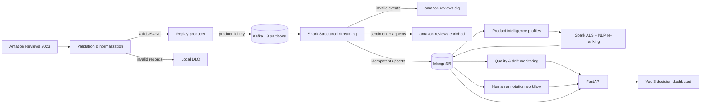

<div align="center">

# Amazon Review Intelligence

### Production-minded Big Data, NLP and recommendation platform

**1,000,000 reviews · 154,311 products · 121,812 personalized user profiles**

An end-to-end data and machine-learning product that turns large-scale Amazon review data into
sentiment intelligence, explainable product insights, and personalized recommendations. It goes
beyond model training: the repository includes resilient streaming, materialized serving data,
scientific evaluation, ML monitoring, a documented API, and a user-facing web application.

[](https://www.python.org/)
[](https://kafka.apache.org/)
[](https://spark.apache.org/)
[](https://www.mongodb.com/)
[](https://fastapi.tiangolo.com/)
[](https://vuejs.org/)
[](https://www.docker.com/)

**[Dashboard](http://localhost:3000)** · **[Interactive API](http://localhost:8000/docs)** · **[Technical report](outputs/rapport_pipeline_1_million.md)**

</div>

---

## Why this project matters

Amazon Review Intelligence demonstrates how to engineer a complete ML product—not only a notebook
or an isolated classifier. A reproducible public dataset is replayed through Kafka, processed with
Spark, enriched by shared NLP inference, aggregated in MongoDB, and exposed through FastAPI to a
Vue decision dashboard.

| Business need | Delivered capability |
|---|---|
| Understand customer opinion at scale | Three-class sentiment with confidence and temporal analysis |
| Explain *why* customers react | Aspect sentiment for quality, price, delivery, packaging, durability, and usability |
| Help users discover relevant products | Hybrid ALS + NLP Top-10 recommendations with readable reasons |
| Keep ML results trustworthy | Human annotation, leakage-controlled evaluation, quality checks, and drift monitoring |
| Turn models into a usable product | Searchable product catalog, REST API, dashboard, Docker runtime, and resumable jobs |

### Engineering strengths demonstrated

- **Data engineering:** contracts, replayable ingestion, Kafka partitioning, DLQ, Spark streaming,
  checkpoints, idempotent writes, retry policies, and resumable backfills.
- **Applied machine learning:** sentiment classification, aspect-level analysis, collaborative
  filtering, hybrid ranking, confidence analysis, and cold-start handling.
- **ML evaluation:** chronological splits, human-reviewed gold-set workflow, Precision/Recall,
  Macro-F1, NDCG, MRR, coverage, diversity, novelty, PSI, and Jensen–Shannon divergence.
- **Backend and product engineering:** versioned models, materialized recommendations, MongoDB
  serving collections, FastAPI/OpenAPI, Vue 3/TypeScript, and responsive UX.
- **Reproducibility:** one-command Docker services, explicit model versions, persisted job state,
  automated tests, and reports stored separately from source code.

The application guides users through a coherent decision journey:

1. **Understand** global customer sentiment and rating patterns.
2. **Explore** named products, metadata, quality scores, and real customer comments.
3. **Analyze** any review with live three-class sentiment inference.
4. **Decide** with personalized, explainable Top-10 recommendations.

> **Real-time scope:** the source is the reproducible Amazon Reviews 2023 public dataset. Historical
> events are replayed through Kafka to simulate a production event stream; the project does not
> scrape Amazon's live website or bypass access controls.

## Verified outcomes

| Outcome | Verified result |
|---|---:|
| Reviews processed and stored | **1,000,000** |
| Product intelligence profiles | **154,311** |
| Products enriched with names and metadata | **154,294 (99.989%)** |
| Users with personalized Top-10 recommendations | **121,812** |
| Reviews processed by aspect backfill | **1,000,000** |
| Reviews with at least one detected aspect | **441,315 (44.13%)** |
| Kafka partitions for review topics | **8** |
| NLP training sample | **150,000 balanced reviews** |
| Chronological NLP test set | **30,000 reviews** |
| Sentiment macro-F1 | **0.757** |

Observed sentiment distribution on the one-million-review run:

| Sentiment | Reviews | Average confidence |
|---|---:|---:|
| Positive | 674,808 | 0.864 |
| Negative | 163,429 | 0.764 |
| Neutral | 161,763 | 0.654 |

Detailed evidence and methodology are available in the
[one-million-review validation report](outputs/rapport_pipeline_1_million.md).

## Architecture



### Delivery status

| Capability | Status | Evidence |
|---|---|---|
| Million-review Kafka/Spark pipeline | **Complete** | MongoDB contains 1,000,000 enriched reviews |
| Product metadata enrichment | **Complete** | 154,294 of 154,311 profiles enriched |
| Sentiment inference and analytics | **Complete** | Versioned model and measured chronological test report |
| Aspect-based sentiment | **Complete** | Full-corpus backfill with 441,315 matched reviews |
| Hybrid recommender | **Complete** | 121,812 materialized Top-10 user profiles |
| Recommender offline evaluation | **Implemented** | Leakage-controlled temporal benchmark workflow |
| Data-quality and NLP-drift monitoring | **Implemented** | Materialized snapshots, thresholds, alerts, and dashboard |
| Human gold dataset | **In progress** | 1,500 balanced tasks prepared for independent annotation |

“Implemented” means the capability and reproducible execution path are delivered; metrics are not
presented as measured results until the corresponding job has been run on the target environment.

## What makes this project distinctive

### Streaming that survives real failures

- Kafka topics are provisioned automatically and partitioned by `product_id`.
- Spark Structured Streaming limits micro-batches to 20,000 events.
- Invalid events are preserved in a dead-letter topic instead of silently discarded.
- MongoDB writes are idempotent, retryable, and safe to resume.
- Spark checkpoints preserve stream progress across container restarts.
- The metadata importer resumes after truncated gzip/network streams and skips completed work.
- Recommendation generation resumes from already materialized users after interruption.

### NLP designed as a measurable component

- Weak labels are generated from ratings: 1–2 negative, 3 neutral, 4–5 positive.
- Class-wise reservoir sampling produces a balanced 150k sample without loading the corpus in memory.
- A chronological split makes evaluation closer to future production behavior.
- TF-IDF unigram/bigram features feed a class-weighted logistic regression model.
- Each prediction includes a label, confidence score, model name, and model version.
- Spark and FastAPI use the same serialized inference pipeline.

| Class | F1-score |
|---|---:|
| Negative | 0.773 |
| Neutral | 0.639 |
| Positive | 0.857 |
| **Macro average** | **0.757** |

### Aspect intelligence that explains sentiment

Global polarity alone does not explain whether customers react to a product's price, quality, or
delivery. The aspect pipeline therefore:

- detects **quality, price, delivery, packaging, durability, and usability** at sentence level;
- applies the same versioned sentiment model only to relevant evidence;
- stores aspect label, confidence, mention count, and supporting sentences with each review;
- enriches new streaming events and provides a resumable historical backfill;
- exposes global and per-product aspect distributions through FastAPI and the dashboard.

The completed backfill processed all **1,000,000 reviews** and found at least one supported aspect
in **441,315 reviews**. The deliberately transparent lexicon/sentence approach makes its behavior
auditable and establishes a measurable baseline for a future ABSA Transformer.

### Hybrid recommendations, not a popularity list

Spark ALS learns collaborative preferences from user–product interactions. Candidates are
re-ranked with customer sentiment and popularity:

```text
hybrid_score = 0.65 × ALS affinity
             + 0.25 × NLP-backed product quality
             + 0.10 × normalized popularity
```

Product quality combines confidence-adjusted sentiment, average rating, and verified-purchase
ratio. Recommendations carry human-readable reasons. Cold-start users receive a quality/popularity
fallback rather than an error.

The recommender also includes a leakage-controlled offline benchmark. For every eligible user,
the chronologically latest interaction is hidden, while ALS and NLP product-quality signals are
rebuilt from earlier interactions only. The same users are evaluated against four strategies:
popularity, NLP quality, ALS, and the production hybrid. The report exposes Precision@10,
Recall/HitRate@10, NDCG@10, MRR@10, catalog coverage, category diversity, and novelty.

### Scientific validation and ML monitoring

The project treats model quality as an operational responsibility:

- a blinded interface prepares **1,500 balanced human-annotation tasks**;
- 20% of tasks require double annotation for Cohen's kappa and conflict adjudication;
- human labels can generate accuracy, Macro-F1, per-class metrics, and a confusion matrix;
- data-quality audits detect broken contracts, empty text, invalid ratings, and duplicates;
- two consecutive event-time windows measure sentiment drift with **Jensen–Shannon divergence**;
- confidence drift is measured with **Population Stability Index (PSI)**;
- explicit thresholds produce `healthy`, `warning`, or `critical` alerts;
- snapshots are materialized in MongoDB so API requests never trigger million-row scans.

### A user-facing ML product

The Vue interface is organized around **Understand → Explore → Analyze → Decide** and includes:

- global sentiment and rating visualizations;
- product discovery by name, brand, category, or reference;
- product images, prices, features, descriptions, and representative comments;
- one-click transfer of a real review into the live NLP laboratory;
- personalized recommendations with score decomposition;
- aspect-level explanations and representative customer evidence;
- a blinded human-annotation and adjudication workspace;
- data-quality, model-confidence, and temporal-drift monitoring;
- human-friendly demo profiles with technical IDs hidden behind an advanced control;
- responsive dark/light themes and a dedicated pipeline health view.

## Technology choices

| Layer | Technology | Responsibility |
|---|---|---|
| Data contracts | Pydantic | Validation, normalization, schema versioning |
| Event transport | Apache Kafka 4.1 | Partitioned review stream and DLQ |
| Stream processing | Spark Structured Streaming 4.2 | Validation, deduplication, batch NLP inference |
| NLP | scikit-learn | TF-IDF + weighted logistic regression |
| Aspect intelligence | Sentence rules + shared NLP model | Explainable per-aspect evidence and polarity |
| Recommendations | Spark MLlib ALS | Collaborative filtering and candidate generation |
| ML monitoring | MongoDB aggregations + statistical metrics | Data quality, JSD/PSI drift, operational alerts |
| Serving store | MongoDB 8 | Reviews, profiles, recommendations, registry |
| API | FastAPI | Analytics, product discovery, inference, recommendations |
| Web application | Vue 3, TypeScript, Vite, ECharts | Interactive decision experience |
| Runtime | Docker Compose | Reproducible multi-service environment |

## MongoDB serving model

| Collection | Purpose |
|---|---|
| `reviews_enriched` | Canonical reviews with sentiment and model traceability |
| `product_profiles` | Aggregated quality, sentiment, verification, and product metadata |
| `user_recommendations` | Materialized personalized Top-10 per eligible user |
| `recommendation_fallbacks` | Quality/popularity selection for cold-start users |
| `recommendation_evaluations` | Temporal benchmark and comparable ranking metrics |
| `annotation_tasks` | Blinded labels, double annotation, and expert adjudication |
| `nlp_evaluations` | Human-grounded sentiment metrics and confusion matrix |
| `monitoring_snapshots` | Versioned data-quality and NLP-drift reports |
| `model_registry` | Model version, weights, training status, and document counts |
| `pipeline_jobs` | Resumable enrichment progress and operational status |

## Product walkthrough

Once the stack is running, a reviewer can validate the project without reading the source first:

1. Open the dashboard and inspect the one-million-review sentiment and rating overview.
2. Search products by human-readable name, brand, or category and open real review evidence.
3. Compare aspect sentiment to understand whether price, quality, delivery, or durability drives
   customer opinion.
4. Paste a review into the NLP laboratory and obtain a live label, confidence, and aspect evidence.
5. Select a demonstration user and inspect personalized Top-10 recommendations and their reasons.
6. Open the system view to inspect pipeline health, data quality, confidence, and temporal drift.
7. Use the annotation workspace to see how a human-reviewed evaluation corpus is constructed.

This flow makes the repository suitable for discussion in **Data Engineer, ML Engineer, Data
Scientist, Backend Python, and Applied AI** interviews.

## Quick start

### Prerequisites

- Docker Desktop with Docker Compose
- Git
- Python 3.11+ for local preparation and tests
- At least 8 GB of memory available to Docker for the complete pipeline

### 1. Clone and install

```bash
git clone https://github.com/btissam75/amazon-review-intelligence.git
cd amazon-review-intelligence
python -m venv .venv
```

```powershell
.venv\Scripts\Activate.ps1
pip install -e ".[nlp,streaming,api,dev]"
```

### 2. Prepare one million validated reviews

Source archives are streamed and are not committed to Git.

```powershell
ari-prepare download --category All_Beauty --limit 600000 --output data/clean/reviews_All_Beauty.jsonl --dlq data/clean/reviews_All_Beauty.dlq.jsonl --report data/reports/quality_All_Beauty.json
ari-prepare download --category Appliances --limit 400000 --output data/clean/reviews_Appliances.jsonl --dlq data/clean/reviews_Appliances.dlq.jsonl --report data/reports/quality_Appliances.json
```

Use a smaller `--limit` for a fast local smoke test.

### 3. Train the sentiment model

```powershell
ari-train-baseline --input-pattern "data/clean/reviews_*.jsonl" --max-per-class 50000
```

This creates `models/sentiment_baseline.joblib` and a report under `data/reports/`. Models and
datasets are intentionally excluded from Git.

### 4. Start and feed the streaming pipeline

```powershell
docker compose up -d --build kafka kafka-init mongodb spark-streaming
docker compose --profile ingest run --rm producer
```

```powershell
docker compose logs -f spark-streaming
```

### 5. Build recommendation and product intelligence

Run these after Spark has materialized the review corpus:

```powershell
docker compose --profile recommendation build recommender
docker compose --profile recommendation run --rm recommender
docker compose --profile metadata build metadata-enricher
docker compose --profile metadata run --rm metadata-enricher
```

### 6. Launch the product

```powershell
docker compose up -d --build api frontend
```

- Dashboard: <http://localhost:3000>
- OpenAPI/Swagger: <http://localhost:8000/docs>
- Health check: <http://localhost:8000/health>

```powershell
Invoke-RestMethod http://localhost:8000/api/v1/analytics/overview | ConvertTo-Json -Depth 5
```

### 7. Build the human-reviewed gold dataset

Create a balanced sample of 500 reviews per weak class. Twenty percent of the tasks require two
independent annotations so that inter-annotator agreement can be measured with Cohen's kappa.

```powershell
docker compose run --rm api python -m amazon_review_intelligence.annotation.bootstrap
```

Open <http://localhost:3000/annotations>. The annotation screen deliberately hides the Amazon
rating and model prediction until the human decision is saved. Conflicting double annotations can
be adjudicated from the same interface. Ambiguous reviews can be marked `uncertain`; they are
excluded from the gold export until an expert adjudicates them.

Export only completed consensus/adjudicated records:

```powershell
docker compose run --rm api python -m amazon_review_intelligence.annotation.export
```

The command writes `data/annotations/reviewed_reviews.jsonl` and
`data/reports/annotation_report.json`. The report includes completion, conflicts, class
distribution, double-annotation coverage, and Cohen's kappa.

### 8. Evaluate NLP against human decisions

Once reviewed annotations have been exported, evaluate the exact serialized model served by the
API. The command calculates accuracy, Macro-F1, per-class precision/recall/F1, confidence
statistics, disagreement analysis, and the confusion matrix.

```powershell
docker compose run --rm api python -m amazon_review_intelligence.nlp.evaluate_human
```

Results are written to `data/reports/nlp_human_evaluation.json` and
`data/reports/nlp_confusion_matrix.png`, persisted in `nlp_evaluations`, exposed by FastAPI, and
shown in the dashboard. The report always includes the evaluated human-corpus size, preventing a
partial annotation sample from being mistaken for the final benchmark.

### 9. Enrich sentiment by product aspect

The aspect pipeline detects quality, price, delivery, packaging, durability, and usability at
sentence level. It applies the serialized sentiment model only to relevant sentences, stores
evidence and confidence with every review, and can safely resume after interruption.

```powershell
docker compose --profile aspects build aspect-enricher
docker compose --profile aspects run --rm aspect-enricher
```

This historical backfill may take time on one million reviews. Progress is persisted in the
`pipeline_jobs` collection, while already versioned reviews are skipped on every restart. New
Kafka events receive the same enrichment directly in Spark Structured Streaming.

### 10. Evaluate recommendation quality

Run the temporal leave-last-one-out benchmark after the cleaned corpus and sentiment model are
available. This job is isolated from serving and never overwrites production recommendations.

```powershell
docker compose --profile evaluation build recommender-evaluation
docker compose --profile evaluation run --rm recommender-evaluation
```

The result is stored in MongoDB, attached to `hybrid-als-nlp-v1` in the model registry, written to
`data/reports/recommender_evaluation.json`, exposed by the API, and rendered in the dashboard.

### 11. Audit data quality and NLP drift

Build a materialized monitoring snapshot after the corpus or NLP model changes:

```powershell
docker compose --profile monitoring build monitoring
docker compose --profile monitoring run --rm monitoring
```

The audit validates the review contract, measures empty or invalid records, duplicate content,
low-confidence predictions, and aspect coverage. It compares two consecutive 90-day event-time
windows using Jensen–Shannon divergence for sentiment distribution and Population Stability Index
(PSI) for model confidence. Explicit thresholds produce `healthy`, `warning`, or `critical`
alerts. Snapshots are stored in `monitoring_snapshots`, exported to
`data/reports/data_quality_drift.json`, and displayed in **Pipeline & system** without running
million-row aggregations during an API request.

## API surface

| Method | Endpoint | Purpose |
|---|---|---|
| `GET` | `/health` | Database and recommendation-model readiness |
| `GET` | `/api/v1/analytics/overview` | Corpus, product, user, and model KPIs |
| `GET` | `/api/v1/analytics/sentiments` | Sentiment distribution and confidence |
| `GET` | `/api/v1/analytics/details` | Ratings, verified purchases, categories |
| `GET` | `/api/v1/analytics/aspects` | Aspect sentiment globally or for one product |
| `GET` | `/api/v1/monitoring/status` | Latest data-quality and NLP-drift snapshot |
| `GET` | `/api/v1/monitoring/history` | Lightweight operational monitoring history |
| `GET` | `/api/v1/products` | Paginated search and quality filtering |
| `GET` | `/api/v1/products/{product_id}` | Product intelligence and customer reviews |
| `GET` | `/api/v1/users/sample` | Demonstration profiles for the UI |
| `GET` | `/api/v1/annotations/progress` | Gold-dataset progress and agreement |
| `GET` | `/api/v1/annotations/next` | Next blinded annotation task |
| `POST` | `/api/v1/annotations/{review_id}` | Save an independent human label |
| `GET` | `/api/v1/annotations/conflicts/next` | Next task requiring adjudication |
| `POST` | `/api/v1/annotations/{review_id}/adjudicate` | Resolve an annotation conflict |
| `GET` | `/api/v1/nlp/evaluation` | Sentiment metrics against human-reviewed labels |
| `GET` | `/api/v1/recommendations/evaluation` | Temporal offline recommender benchmark |
| `GET` | `/api/v1/recommendations/{user_id}` | Personalized or cold-start Top-10 |
| `GET` | `/api/v1/recommendations` | Global fallback ranking |
| `POST` | `/api/v1/sentiment/predict` | Live sentiment inference |
| `POST` | `/api/v1/sentiment/aspects` | Sentence-level aspect sentiment and evidence |

Example:

```bash
curl -X POST http://localhost:8000/api/v1/sentiment/predict \
  -H "Content-Type: application/json" \
  -d '{"text":"Excellent quality and very easy to use."}'
```

## Testing and quality gates

```powershell
pytest
ruff check src tests
python -m compileall -q src
docker compose config --quiet
cd frontend
npm ci
npm run typecheck
npm run build
```

Tests cover event normalization, preparation, chronological NLP splitting, inference, aspect
analysis, annotation workflows, API behavior, hybrid ranking, recommendation metrics, drift
statistics, and alert thresholds.

## Repository structure

```text
amazon-review-intelligence/
├── frontend/                         # Vue 3 decision dashboard
├── infrastructure/                   # Dockerfiles and Nginx configuration
├── src/amazon_review_intelligence/
│   ├── api/                          # FastAPI routes and schemas
│   ├── data/                         # Preparation, profiling, metadata enrichment
│   ├── nlp/                          # Training and shared inference
│   ├── monitoring/                   # Data quality, drift metrics, and alerts
│   ├── recommendation/               # Spark ALS and hybrid scoring
│   └── streaming/                    # Kafka producer and Spark job
├── tests/                            # Automated unit and API tests
├── outputs/                          # Specifications and validation reports
├── docker-compose.yml                # Complete local platform
└── pyproject.toml                    # Python package and CLI entry points
```

## Engineering decisions

- **Replay instead of live scraping:** reproducible experiments, stable schemas, and respectful
  use of the public research dataset.
- **MongoDB as the serving layer:** Spark computes; the API reads indexed, materialized documents.
- **Materialized recommendations:** predictable API latency and model-version traceability.
- **Idempotency by design:** review and recommendation upserts allow safe retries.
- **Chronological evaluation:** reduces optimistic leakage compared with a random-only split.
- **Transparent baseline first:** measurable behavior and fast distributed inference before a
  more expensive Transformer.

## Limitations and roadmap

This project reports measured results without presenting the baseline as a finished production
model. Rating-derived labels contain noise, and the neutral class remains the main weakness.

Planned extensions:

- DistilBERT/DeBERTa comparison on a manually reviewed evaluation subset;
- scheduled monitoring, alert delivery, and automated retraining policies;
- authentication, rate limiting, CI/CD, observability, and deployment manifests;
- multilingual sentiment and localized product experiences.

## Data provenance and responsible use

The project uses [Amazon Reviews 2023](https://amazon-reviews-2023.github.io/main.html), published
by the McAuley Lab for research. Content and metadata remain subject to the dataset's original
terms. Datasets, generated models, checkpoints, and database volumes are excluded from Git.

This repository is an engineering and research demonstration. Recommendations should not drive
consequential decisions without further validation, bias analysis, privacy review, and monitoring.

## Project documentation

- [Functional and technical specification](outputs/cahier_des_charges_amazon_nlp.md)
- [One-million-review validation report](outputs/rapport_pipeline_1_million.md)
- [Initial delivery progress report](outputs/rapport_avancement_lot1.md)

## Portfolio summary

> Engineered an end-to-end Amazon review intelligence platform processing 1M events with Kafka
> and Spark, serving sentiment and aspect analytics from MongoDB, and generating explainable hybrid
> ALS/NLP recommendations for 121,812 users through FastAPI and Vue 3. Added human evaluation,
> leakage-controlled ranking metrics, resilient Docker workflows, and ML drift monitoring.

---

<div align="center">

Built by **[Btissam Arehal](https://github.com/btissam75)** as an end-to-end demonstration of
data engineering, distributed ML, backend engineering, and product-focused analytics.

</div>
