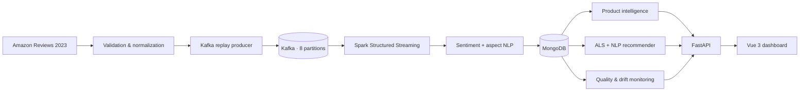

<div align="center">

# Amazon Review Intelligence

### Big Data · NLP · Recommendation Systems · MLOps

An end-to-end platform that transforms **1,000,000 Amazon reviews** into customer sentiment,
product intelligence, and personalized recommendations through a resilient streaming pipeline
and an interactive decision dashboard.

[](https://www.python.org/)
[](https://kafka.apache.org/)
[](https://spark.apache.org/)
[](https://www.mongodb.com/)
[](https://fastapi.tiangolo.com/)
[](https://vuejs.org/)
[](https://www.docker.com/)

**[Dashboard](http://localhost:3000)** · **[Swagger API](http://localhost:8000/docs)** · **[Technical report](outputs/rapport_pipeline_1_million.md)**

</div>

---

## Project impact

| Delivered outcome | Result |
|---|---:|
| Reviews processed through the data pipeline | **1,000,000** |
| Product intelligence profiles | **154,311** |
| Products enriched with readable metadata | **154,294** |
| Users with personalized Top-10 recommendations | **121,812** |
| Reviews analyzed for product aspects | **1,000,000** |
| Reviews containing detected aspects | **441,315** |
| Sentiment Macro-F1 | **0.757** |

The platform turns customer feedback into four directly usable capabilities:

- **Understand** global sentiment, ratings, confidence, and customer trends.
- **Explain** opinions by quality, price, delivery, packaging, durability, and usability.
- **Recommend** relevant products with a hybrid ALS + NLP ranking model.
- **Monitor** data quality, model confidence, and temporal NLP drift.

## Core capabilities

### Scalable data pipeline

- Kafka topics partitioned for high-throughput review ingestion.
- Spark Structured Streaming for validation, enrichment, and NLP inference.
- Dead-letter handling, checkpoints, retries, and idempotent MongoDB upserts.
- Resumable metadata, aspect, recommendation, and monitoring jobs.

### Sentiment and aspect intelligence

- Three-class sentiment classification: `positive`, `neutral`, and `negative`.
- Confidence score and model version attached to every prediction.
- Sentence-level aspect analysis with supporting customer evidence.
- Shared inference pipeline across Spark streaming and FastAPI.

### Explainable hybrid recommendations

```text
hybrid_score = 0.65 × ALS affinity
             + 0.25 × NLP-backed product quality
             + 0.10 × normalized popularity
```

- Collaborative filtering with Spark MLlib ALS.
- NLP quality signals, ratings, popularity, and verified-purchase information.
- Personalized Top-10 recommendations with human-readable reasons.
- Quality/popularity strategy for new users.

### Evaluation and ML monitoring

- Chronological sentiment evaluation with per-class metrics and Macro-F1.
- Human annotation workspace with double annotation and adjudication.
- Temporal recommender benchmark with Precision, Recall, NDCG, MRR, coverage, diversity, and novelty.
- Data-quality checks and temporal drift monitoring with Jensen–Shannon divergence and PSI.
- Versioned monitoring snapshots and actionable dashboard alerts.

### Product-focused web experience

- Executive analytics dashboard for one million reviews.
- Searchable products with names, brands, images, prices, and comments.
- Live NLP laboratory for sentiment and aspect predictions.
- Personalized recommendation explorer with score explanations.
- Annotation workspace and technical monitoring center.
- Responsive Vue 3 interface with dark and light themes.

## Architecture



## Technology stack

| Layer | Technologies |
|---|---|
| Data engineering | Python, Pydantic, Apache Kafka, Spark Structured Streaming |
| Machine learning | scikit-learn, TF-IDF, Logistic Regression, Spark MLlib ALS |
| NLP intelligence | Sentiment classification, aspect analysis, confidence scoring |
| Serving and storage | MongoDB, FastAPI, OpenAPI |
| Frontend | Vue 3, TypeScript, Vite, ECharts |
| MLOps and runtime | Docker Compose, model registry, checkpoints, monitoring snapshots |
| Quality | Pytest, Ruff, TypeScript checks, production frontend build |

## Quick start

### Prerequisites

- Docker Desktop with Docker Compose
- Git
- At least 8 GB of memory available to Docker for the complete workflow

```bash
git clone https://github.com/btissam75/amazon-review-intelligence.git
cd amazon-review-intelligence
docker compose up -d --build api frontend
```

Open:

- Dashboard: <http://localhost:3000>
- Interactive API: <http://localhost:8000/docs>
- Health endpoint: <http://localhost:8000/health>

<details>
<summary><strong>Reproduce the complete one-million-review workflow</strong></summary>

### 1. Install the project tools

```powershell
python -m venv .venv
.venv\Scripts\Activate.ps1
pip install -e ".[nlp,streaming,api,dev]"
```

### 2. Prepare and train

```powershell
ari-prepare download --category All_Beauty --limit 600000 --output data/clean/reviews_All_Beauty.jsonl --dlq data/clean/reviews_All_Beauty.dlq.jsonl --report data/reports/quality_All_Beauty.json
ari-prepare download --category Appliances --limit 400000 --output data/clean/reviews_Appliances.jsonl --dlq data/clean/reviews_Appliances.dlq.jsonl --report data/reports/quality_Appliances.json
ari-train-baseline --input-pattern "data/clean/reviews_*.jsonl" --max-per-class 50000
```

### 3. Run the streaming pipeline

```powershell
docker compose up -d --build kafka kafka-init mongodb spark-streaming
docker compose --profile ingest run --rm producer
```

### 4. Build intelligence layers

```powershell
docker compose --profile metadata run --rm --build metadata-enricher
docker compose --profile recommendation run --rm --build recommender
docker compose --profile aspects run --rm --build aspect-enricher
docker compose --profile evaluation run --rm --build recommender-evaluation
docker compose --profile monitoring run --rm --build monitoring
```

### 5. Launch the application

```powershell
docker compose up -d --build api frontend
```

</details>

## Selected API endpoints

| Method | Endpoint | Purpose |
|---|---|---|
| `GET` | `/api/v1/analytics/overview` | Main corpus and model indicators |
| `GET` | `/api/v1/analytics/sentiments` | Sentiment distribution and confidence |
| `GET` | `/api/v1/analytics/aspects` | Global or product-level aspect intelligence |
| `GET` | `/api/v1/products` | Product search and quality filtering |
| `GET` | `/api/v1/products/{product_id}` | Product profile and customer evidence |
| `GET` | `/api/v1/recommendations/{user_id}` | Personalized Top-10 recommendations |
| `GET` | `/api/v1/recommendations/evaluation` | Temporal recommender benchmark |
| `GET` | `/api/v1/monitoring/status` | Latest quality and drift snapshot |
| `POST` | `/api/v1/sentiment/predict` | Live sentiment inference |
| `POST` | `/api/v1/sentiment/aspects` | Live aspect-based sentiment inference |

## Repository structure

```text
amazon-review-intelligence/
├── frontend/                         # Vue 3 analytics application
├── infrastructure/                   # Docker and Nginx configuration
├── src/amazon_review_intelligence/
│   ├── annotation/                   # Human review and adjudication
│   ├── api/                          # FastAPI serving layer
│   ├── data/                         # Preparation and metadata enrichment
│   ├── monitoring/                   # Data-quality and drift intelligence
│   ├── nlp/                          # Training, inference, aspects, evaluation
│   ├── recommendation/               # Spark ALS and hybrid ranking
│   └── streaming/                    # Kafka producer and Spark job
├── tests/                            # Automated quality gates
├── outputs/                          # Specifications and validation reports
├── docker-compose.yml                # Complete local platform
└── pyproject.toml                    # Python package configuration
```

## Portfolio summary

> Engineered an end-to-end Amazon review intelligence platform processing **1 million events**
> with Kafka and Spark, serving sentiment and aspect analytics from MongoDB, and generating
> explainable hybrid ALS/NLP recommendations for **121,812 users** through FastAPI and Vue 3.
> Implemented resilient data workflows, scientific ML evaluation, and quality/drift monitoring.

## Data source

Built with the public [Amazon Reviews 2023](https://amazon-reviews-2023.github.io/main.html)
research dataset published by the McAuley Lab.

## Documentation

- [Functional and technical specification](outputs/cahier_des_charges_amazon_nlp.md)
- [One-million-review validation report](outputs/rapport_pipeline_1_million.md)
- [Initial delivery report](outputs/rapport_avancement_lot1.md)

---

<div align="center">

Built by **[Btissam Arehal](https://github.com/btissam75)**

*Data Engineering · Machine Learning · NLP · Backend Engineering · Data Products*

</div>
